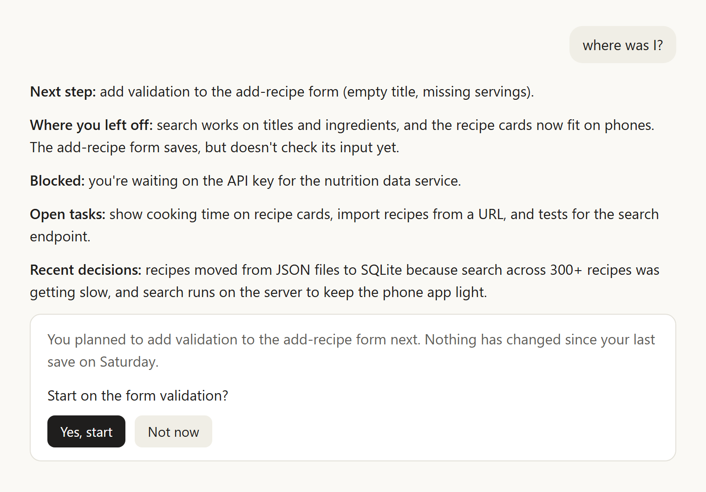
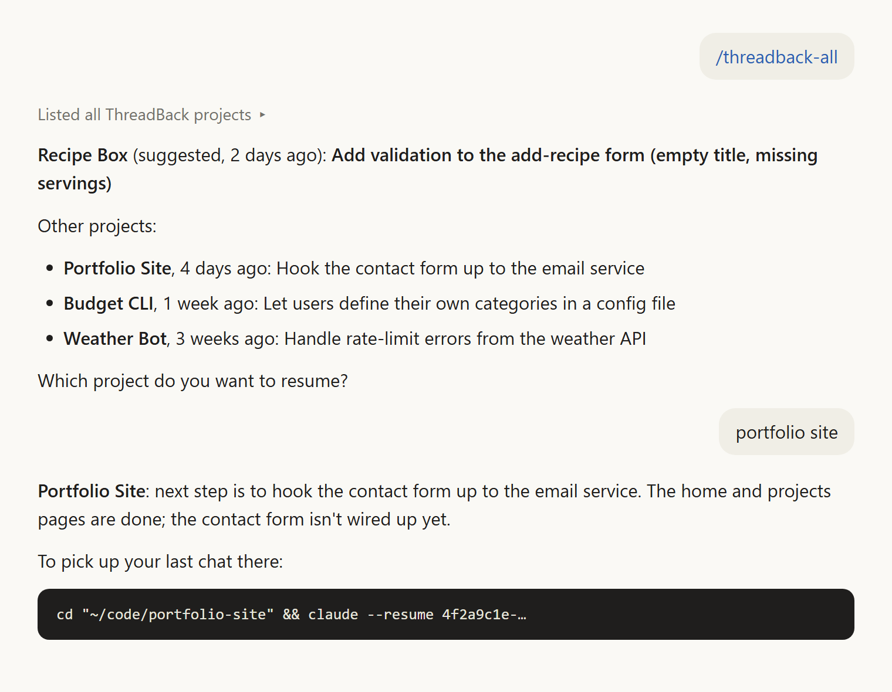
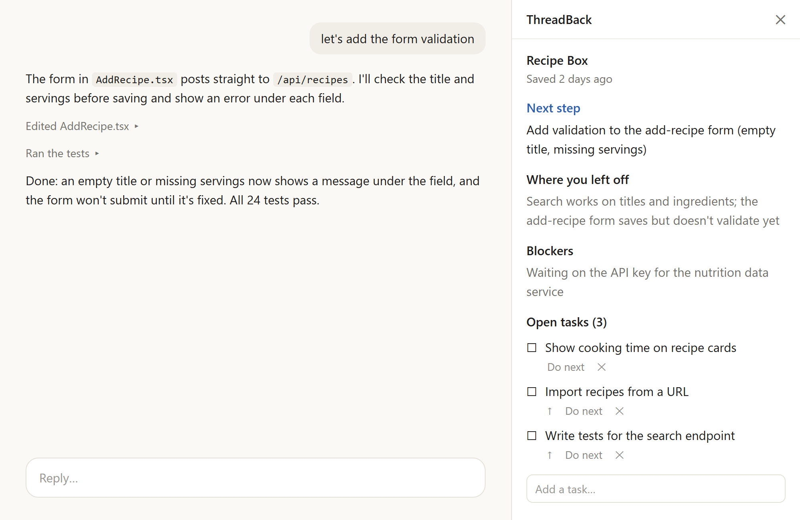

# ThreadBack

**Pick up any project where you left off, with the next step you planned.**

ThreadBack is a Claude Code plugin for people who juggle several projects. When you
come back to one after a few days, or after a weekend on something else, Claude already
knows what you were doing, why, what's unfinished, and what you meant to do next. And
when you're not sure which project to pick up, `/threadback-all` shows all of them with
their next steps.



## How it works

1. **Wrap up with `/threadback-save`.** Claude writes a short summary of the session:
   where things stand, the decisions you made and why, unfinished tasks, and **one
   concrete next step**. Add a note to set the next step yourself:
   `/threadback-save next: write the login tests`.
2. **Come back any time later.** When you open Claude Code in that folder (or any folder
   inside it), Claude is given the saved context automatically. Ask "where was I?" or run
   `/threadback` to see it.
3. **Across projects:** `/threadback-all` lists every project, most recent first, with
   its next step and a suggestion for which one to resume. Pick one and you get the
   command that reopens your last Claude chat there.

Forgot to save? If a chat ends without `/threadback-save`, ThreadBack keeps a free
trace of it (your last messages and Claude's last answer, no AI) and shows it next
time. It never overwrites the next step you planned.

Already have old projects? Open a chat in the folder and run `/threadback-save`. With
nothing to save from the chat itself, Claude catches up from a short, pre-filtered
digest of the folder's commits and earlier Claude chats.



## How it differs from memory plugins

Plugins like [claude-mem](https://github.com/thedotmack/claude-mem) record what Claude
does inside one project and feed it back as memory. ThreadBack is about **you** and
**all your projects**:

- **Your plan, not Claude's log.** It keeps the next step you meant to take, your
  decisions and why, and your open tasks, rather than a record of every tool call.
- **Across projects.** It answers "which project should I pick up, and what's the next
  step there?", not only "what happened in this one?".
- **Light and local.** Plain JSON files in `~/.threadback`, no database, no background
  service, no network calls. AI is only used when you run `/threadback-save`; session
  start, auto-capture and the catch-up digest cost nothing.

They don't conflict, so you can use both.

## Requirements

- [Claude Code](https://claude.com/claude-code) on Windows, macOS or Linux.
- **Python 3.10 or newer**, available as `python3` (macOS/Linux) or `py` / `python`
  (Windows). If Python is missing, new chats show a message saying so and where to get it.
- **bash.** macOS and Linux have it. On Windows, Claude Code already uses Git Bash
  ([Git for Windows](https://git-scm.com/downloads/win)).

No other dependencies: ThreadBack uses only Python's standard library.

## Install

In a terminal (or with `/plugin` inside Claude Code):

```bash
claude plugin marketplace add NikitaDhar31/threadback
```

```bash
claude plugin install threadback@threadback
```

Then start a new Claude Code chat in a project folder and run `/threadback-save` at the
end to start tracking it.

## Commands

| Command | What it does |
|---|---|
| `/threadback-save [note]` | Saves this session: summary, where you left off, decisions, tasks, next step. In a new folder it starts tracking it as a project. |
| `/threadback` | Shows where you left off in this project, next step first. |
| `/threadback-all [project]` | Lists all your projects and their next steps, and helps you resume one. |

You don't need a command at the start of a chat: the context is handed to Claude
automatically, and Claude only brings it up when it's relevant.

## Optional: the panel (experimental)

`threadback-panel` is a second plugin that shows the current project's next step, where
you left off and your open tasks in a panel beside the chat. You can tick tasks off, add
them, reorder them and choose the next step there, with no AI involved.

```bash
claude plugin install threadback-panel@threadback
```

It needs the `threadback` plugin and a Claude Code version with mods, which are early
access and may change between releases. That's why it's a separate plugin: ThreadBack
itself works without it.



## Privacy: what ThreadBack reads, keeps and sends

**In short:** everything stays on your computer. ThreadBack has no server, no account,
no analytics and makes no network requests. The only thing that leaves your machine is
the short context it hands to Claude, which travels with your conversation like anything
you type.

**What it reads** (read-only, never changed):

- **Your project folders:** git branch, recent commit messages and changed file names,
  uncommitted file names, and the first lines of the README. It runs local `git`
  commands only, never `git fetch` or anything that talks to a remote.
- **Claude Code's own chat files** in `~/.claude/projects/<folder-name>/`, which Claude
  Code already keeps on your disk: chat titles, dates, your messages and Claude's last
  answer in each chat. Tool output and file contents inside those chats are skipped.
- Nothing else: not your other files, not your browser, not any cloud account.

**What it keeps**, all in `~/.threadback/` (set `THREADBACK_HOME` to move it, e.g. into
a synced folder):

- `projects/<slug>.json`: one plain, hand-editable file per project: summaries, next
  step, tasks, decisions, and the auto-saved messages of chats that ended without a save.
- `dashboard.html`, `hook-errors.log`, and `tb-path` (where the plugin is installed, for
  the optional panel).
- On Windows, only if you turn on the welcome window: a login script and a desktop shortcut.

Nothing is stored in this repository, so personal context never gets committed. To
remove everything, uninstall the plugin and delete `~/.threadback`.

**What it sends:** ThreadBack itself sends nothing. When a chat starts, and when you run
`/threadback`, `/threadback-all` or `/threadback-save`, it gives Claude the saved context
(and, for a catch-up, a page-long digest of the folder). That text becomes part of your
conversation, so Claude Code sends it to Anthropic with the rest of the chat, under the
same terms as your own messages.

**Secrets:** before anything is saved or handed to Claude, keys and passwords are
masked as `[REDACTED]`: API keys (Anthropic, OpenAI, GitHub, AWS, Google, Slack,
Stripe, ...), JWTs, private keys, bearer tokens, passwords in URLs and `password=` /
`api_key:` style values. This is best effort: a random string with no known shape or
label can slip through.

## Command line

Everything also works from a terminal, without Claude. From a clone of this repo
(use `python3` instead of `py` outside Windows):

```bash
py -m threadback                      # all projects, and which one to resume
py -m threadback show "my project"    # full brief for one project
py -m threadback save "my project"    # save a session by answering a few prompts
py -m threadback task add "write tests"
py -m threadback link "my project" "ChatGPT: API design" https://chatgpt.com/c/...
py -m threadback dashboard            # HTML overview in your browser
```

Project names match loosely (`show my` finds "My Project" if that's unambiguous). Run
`py -m threadback --help` for every command and option, including `digest`, `open`
and `edit`. ChatGPT and claude.ai chats have no local files to read, so you add links to
them yourself with `link`.

### Windows extra: welcome window

On Windows, `py -m threadback startup install` opens a small welcome window when you
log in, and puts a ThreadBack icon on your desktop. It shows the project to resume, its
next step, and a **Save** button for each project. It needs no admin rights and makes no
registry changes; `startup remove` deletes both. It's optional and Windows only.

## Development

```bash
py -m unittest discover -s tests -t .
```

GitHub Actions runs the tests on Windows, macOS and Linux for every push. The panel's
tests run with `claude plugin test panel`.

To try your changes in Claude Code, add your clone as a marketplace:
`claude plugin marketplace add <path-to-your-clone>`. Claude Code runs an installed
*copy* of the plugin, so after changing the code, bump `version` in
`.claude-plugin/plugin.json` (updates are skipped otherwise), then:

```bash
claude plugin marketplace update threadback
```

```bash
claude plugin update threadback@threadback
```

Hooks use only the documented hook input (`session_id`, `cwd`), and Claude Code's chat
files are read defensively, so a format change hides a section rather than breaking a
session. Hook errors never block a session; they go to `~/.threadback/hook-errors.log`.

## License

MIT. See [LICENSE](LICENSE).
