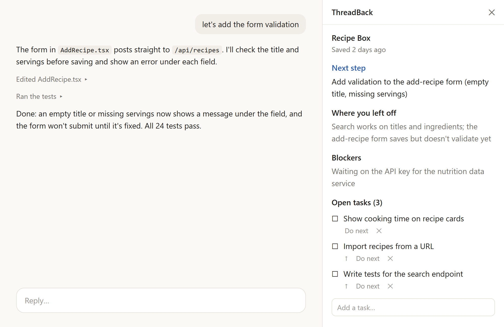

# ThreadBack panel

An optional, experimental companion to the [ThreadBack](https://github.com/NikitaDhar31/threadback)
plugin. It shows the current project's next step, where you left off, blockers and open tasks in
a panel beside the Claude Code chat. You can tick tasks off, add them, move them up, choose the
next step and remove them there, with no AI involved.



## Requirements

- The `threadback` plugin, which saves the projects this panel shows.
- A recent Claude Code with mods (tested on 2.1.309 and later). Mods are early access and may
  change between releases; older versions list the panel as "failed to load".
- Python 3.10 or newer, which ThreadBack itself needs too.

## Install

```bash
claude plugin install threadback-panel@threadback
```

The panel opens beside the chat. Run `/threadback-panel` to open it again after closing it.

## What it reads, runs and sends

- **Reads** ThreadBack's project files in `~/.threadback/projects` (or an absolute
  `THREADBACK_HOME` you set yourself) to find the project for the chat's folder. It ignores a
  relative `THREADBACK_HOME`, and one inside the chat's project, since a project's own settings
  could set it.
- **Runs**, only when you press a task button or add a task, ThreadBack's own `tb.py task ...`
  with your Python. That file comes from the installed `threadback` plugin, which writes its
  location to `~/.threadback/tb-path`. The panel runs it only if it is inside Claude Code's
  plugins folder, and starts it in that file's own folder, never the project's.
- **Sends** nothing: no network requests, no AI calls. What the panel shows stays in the panel.

## License

Created by [Nikita Dhar](https://github.com/NikitaDhar31). MIT licensed, like ThreadBack: see the
[LICENSE](https://github.com/NikitaDhar31/threadback/blob/main/LICENSE) in the repository.
